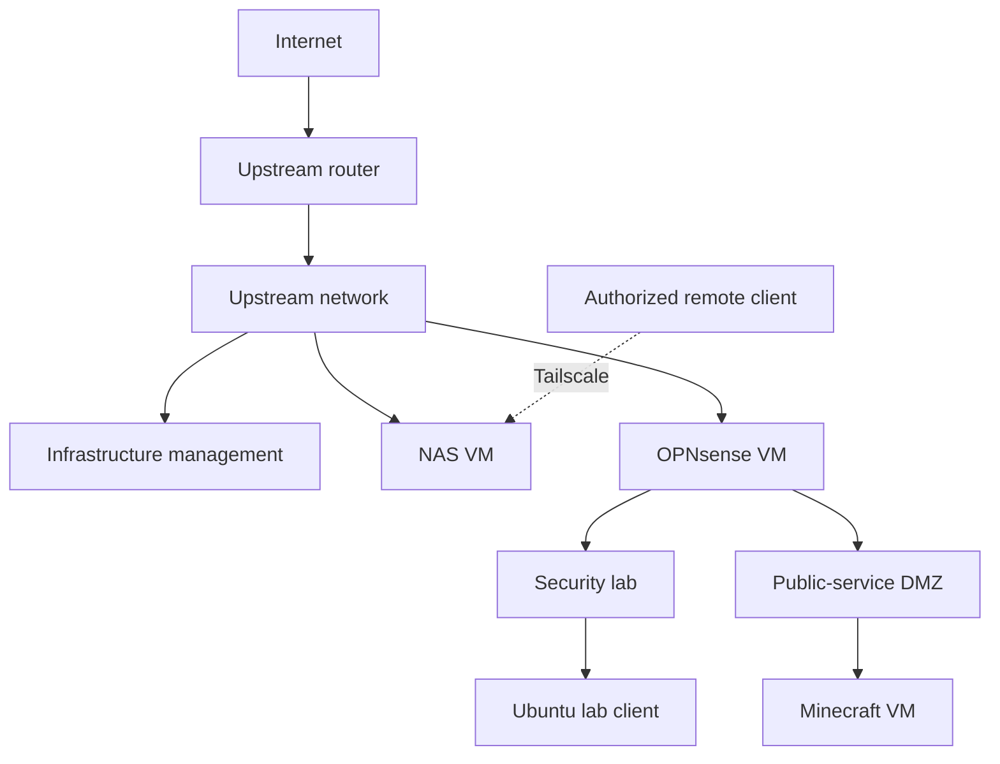

# Architecture Overview

Proxmox hosts the firewall and service VMs. Network policy is enforced by routing, firewall rules, and bridge/VLAN placement, not by VM separation alone.

## Logical Network Design

This is the documented logical design, not a live wiring map. The NAS upstream attachment and actual routes require verification before access changes. The general-purpose Ubuntu server's current network placement is not asserted here.

## VM Hosting

The Proxmox host runs the OPNsense, general-purpose Ubuntu, desktop-lab, NAS, and Minecraft workloads. Exact VM IDs, allocations, interfaces, and active states are maintained privately and must be checked on the host.

## Storage Attachment

The host's external SAS HBA connects to the EMC shelf. Individual data and backup disks are mapped into the NAS VM using stable device identities. The NAS manages their ext4 filesystems. This is disk mapping, not a claim that the entire PCIe HBA is passed through to the guest.

## Trust Boundaries

- Security-lab traffic is intended to be blocked from management systems.
- The public-service DMZ is intended to be blocked from both management and the security lab.
- Tailscale access is a separate path that must be constrained by its own policy and service permissions.
- A directly attached upstream VM may bypass OPNsense; verify actual packet paths.

The proposed Docker VM will require a separate restricted segment. It is not yet part of the deployed architecture. See [networking](networking.md), [security](security.md), and [current state](current-state.md).
